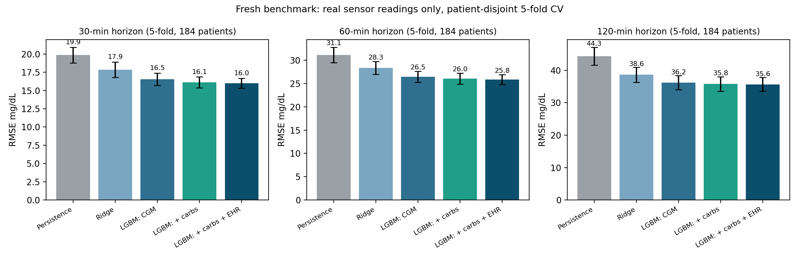

# Fresh rebuild: an independent benchmark, and how it compares with the team pipeline

**Author:** claude (fresh-eyes rebuild, Jarvis run) | **Date:** 2026-09-30
**Scripts:** `build_dataset.py` (data), `train_eval.py` (5-fold benchmark), `compare_team.py` (head-to-head),
`plot_results.py` (figure). **Outputs:** `results.json`, `compare_team.json`, `fresh_benchmark.png`.
Reproduce from the repo root: `python fresh/build_dataset.py`, then `train_eval.py`, then `compare_team.py`.

## 1. Why a rebuild

The team pipeline (`harmonize_5min.py` feeding `train_baselines.py`) works and passes its gates. Rebuilding from the raw files
without looking at its modelling code turned up four data issues:

| # | Issue in the team pipeline | Evidence | Effect |
|---|---|---|---|
| 1 | Only **20 of 109** Shanghai T2DM files are loaded. The other 89 are `.xls` and `xlrd` was not installed. | `ls Shanghai_T2DM`: 89 xls, 20 xlsx | 80 real T2DM patients unused |
| 2 | **Patient leakage:** patients 2001 and 2014 each have two recording files, and one file sits in train while the other sits in test. | `compare_team.json` C | Test set is not fully unseen |
| 3 | 15-min Libre (Shanghai, HUPA) and 1-min-interpolated Dexcom (CGMacros) are linearly **interpolated onto a 5-min grid**, so two-thirds of Shanghai anchors are synthetic points built from a future reading. | 66.6% interpolated; persistence 29.5 vs 30.2 on real anchors | Small in practice (about 0.7 mg/dL easier), but not clean |
| 4 | Targets use `shift(-12)` with no time check. One HUPA patient is 31% of all rows. | 1,556 rows with no real reading at t+60; HUPA0027P 165,291 rows | Row-weighted metrics mostly measure one person |

## 2. Fresh design

- **Data:** real sensor readings only, at each sensor's native cadence. CGMacros Dexcom knots are recovered from the 1-min interpolation, HUPA readings come from the raw LibreView exports (4 layouts parsed), and all 109 Shanghai files are loaded.
  Result: **442,353 readings, 193 recordings, 184 patients** (team: 534,175 rows, 106 subjects).
- **Features:** as-of lags (15 to 180 min), rolling 60/180-min statistics, causal carbohydrate windows, time of day, sensor cadence, and static age/BMI/HbA1c. Static values are measured only; HUPA's are left missing, never simulated.
- **Target:** the real reading nearest t+H, within half a cadence. Each model predicts the change from the current reading.
- **Validation:** 5-fold StratifiedGroupKFold on patient (stratified by cohort), with 1/n patient weighting. Pooled, macro (per-patient) and per-fold figures are all reported.

## 3. Results (5-fold, 184 patients, every patient tested once)

| Model | 30 min | 60 min | 120 min | Clarke A+B at 60 min |
|---|---|---|---|---|
| Persistence | 19.49 | 30.74 | 43.87 | 97.93% |
| Ridge (delta) | 17.46 | 27.99 | 38.38 | 97.22% |
| LightGBM, CGM only | 16.23 | 26.35 | 36.37 | 97.26% |
| LightGBM, + carbs | 15.87 | 25.93 | **35.81** | 97.30% |
| LightGBM, + carbs + static EHR | **15.76** | **25.77** | 35.86 | 97.21% |

The best 60-min model gives a fold RMSE of 25.85 +/- 1.03 and a macro (per-patient) RMSE of 24.50. Against persistence that is **-16.2% at 60 min and -18.3% at 120 min**.
Per cohort at 60 min (best model): BIG IDEAs 18.5, CGMacros 24.6, Shanghai 23.7, HUPA (T1D) 29.2.

## 4. Head-to-head on the team's own 17 test patients

The fresh pipeline was trained on every other patient and scored on the same 17 people (`compare_team.json` A).

| Horizon | Team persistence | Fresh persistence | Team best (LightGBM) | Fresh best (LightGBM + carbs + EHR) |
|---|---|---|---|---|
| 60 min | 32.66 | 32.43 | 27.93 | **26.33** (-1.60) |
| 120 min | 48.07 | 46.64 | 39.54 | **36.05** (-3.49) |

The two persistence floors agree within 0.2-1.4 mg/dL, so both pipelines are measuring the same thing, and the team numbers are
**validated as real**. The fresh model is better by 1.6 and 3.5 mg/dL, mainly from the 80 extra Shanghai patients, the per-patient
weighting, and the delta target.

## 5. Where the fresh result disagrees with the team claim: static EHR fusion

The team reports that static EHR adds +0.74 (60 min) and +1.33 (120 min) mg/dL, with p = 0.006 and 0.035, on 17 test subjects.
Across 153 patients with measured static data, the fresh 5-fold result is **+0.15 mg/dL (p = 0.046) at 60 min and -0.07 (p = 0.47, not significant)
at 120 min**. On the team's 17 patients alone, the fresh gain is +0.66 and +0.61, so the team's effect is real for that sample but
does **not generalise**. **Carbohydrate logging adds more than EHR:** +0.42 at 60 min and +0.56 at 120 min.

## 6. Recommended changes to the submission

1. Headline numbers: report the 5-fold patient-disjoint CV on 184 patients (25.8 +/- 1.0 at 60 min, 35.7 +/- 2.1 at 120 min, -16% and -18% versus persistence).
   This is a stronger claim than a single 17-subject split, and it survives a "did you cherry-pick the split?" question.
2. Soften the fusion claim to "static EHR adds a small, borderline-significant gain at 60 min; meal logging is the larger lever".
   This is also the more useful product message: the twin gets better when the patient logs meals.
3. Say that the 184 patients cover T1D (HUPA), T2DM (Shanghai), prediabetes and healthy people (BIG IDEAs, CGMacros), and give the per-cohort table.
4. Keep the team's deck, dashboard and architecture. The rebuild changes the numbers and one claim, not the product.
